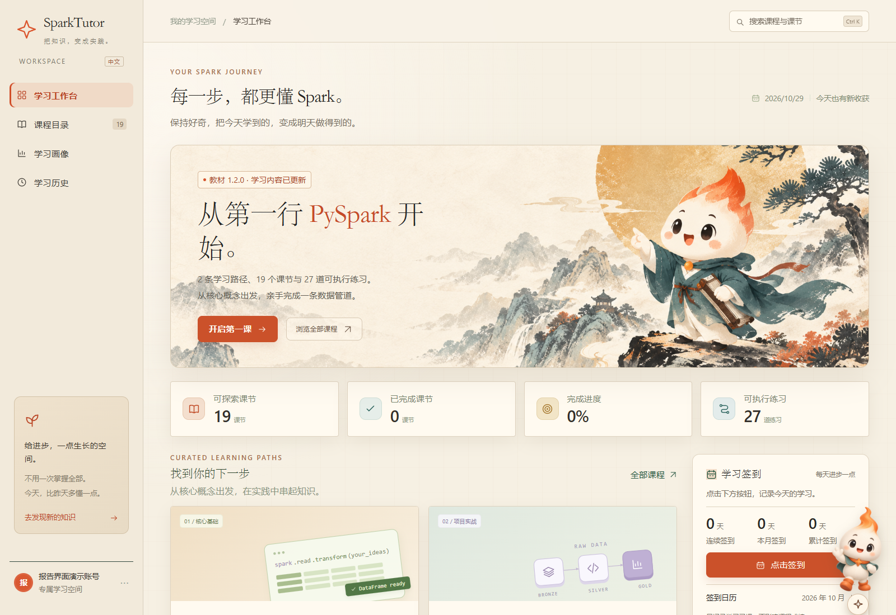

# SparkTutor-Web

**面向中文学习者的 Spark 实训与 AI 调试指导平台。**

在浏览器中阅读课程、编写代码、运行真实 Spark，再结合课程测试、分层提示与学习记录完成调试和复盘。学习者只需浏览器，部署端统一准备执行环境。

**2 条学习路径 · 19 个课节 · 27 道可执行练习 · 8 道证据教练题**

本项目由 **Commit³** 团队基于 [SparkTutor](https://github.com/lisancao/sparktutor) 持续改进，仓库沿用 `SparkTutor-CN` 名称，`master` 提供正式网页版。原 VS Code 扩展保存在 [vscode-legacy](https://github.com/xiangRose/SparkTutor-CN/tree/vscode-legacy) 分支。

[快速体验](#快速体验) · [安装与启动](#新电脑首次安装与启动) · [AI 配置](#ai-配置) · [验证结果](#验证与评估) · [开发与贡献](#开发与验证) · [后续计划](#后续计划)



## 核心功能

- **中文渐进课程**：围绕业务问题、小样例、分步练习和综合任务组织教学，提供初级、中级、高级三档阅读难度。
- **真实 Spark 实操**：登录账号的每次作业使用独立 Linux 容器，课程原始断言核验结果，代码、进度、作业通知与学习记录按账号和题目关联。
- **浏览器编程工作区**：CodeMirror 提供 Python 高亮、基础补全、搜索替换和错误定位；支持逐题保存、刷新恢复、参考答案对比与实时运行输出。
- **证据驱动的 AI 教练**：聚合、Schema、窗口和 Join 四个主题共 8 道题。模型结合题目、代码与记录选择错误假设和证据，系统核验后分层展示概念追问、检查方法及局部示例。
- **可解释的学习反馈**：从有效提交、错误修复、提示使用和新情境任务形成四维画像，展示样本依据、知识点记录、推荐练习与历史复盘。
- **完整的日常学习体验**：国风界面、浅深主题、小屏布局、账号管理、学习签到及可拖动和收起的学习伙伴。学习伙伴支持提问排队、失败恢复，并避让运行和提交等关键操作。

## 快速体验

网站部署好后，可以用一次“发现错误 → 获取指导 → 修复验证 → 复盘”的练习了解主要功能：

1. 登录后进入 **课程目录 → Learning Spark → 认识 Spark：从小样例到第一次分析**，打开独立学习标签页。
2. 在右侧选择 **调试教练**，从支持的练习列表进入 **M&M 糖果计数分析**。该入口直接打开单题练习，保留原来的顺序学习进度。
3. 按题目要求完成函数，点击 **提交判题**。例如把数量求和误写为记录计数，课程测试会拒绝这个业务含义错误的实现。
4. 选择 **概念追问**，再按需要进入 **检查方法**、**局部示例**，查看提示及本次依据。修改后重新提交，以真实课程测试确认结果。
5. 回到 **学习画像** 和 **学习历史**，查看刚才的提交、求助与修复记录，展开计算依据或进入下一道推荐练习。
6. 继续体验 **Join 策略** 中的行数膨胀修复、真实物理计划对照与新情境迁移任务。

真实运行时，输出区域显示 **账号隔离 Spark**。运行与课程测试无需模型密钥；导师问答和调试教练需先完成 [AI 配置](#ai-配置)。


截图使用独立演示账号展示学习工作台与编程界面；实际执行和模型评估记录见下方 [验证与评估](#验证与评估)。

## 课程与 Spark 专项

教材版本为 **1.2.0**，真实课程验证采用 **PySpark 4.1.1**。面向掌握基础 Python、开始系统学习 Spark 的学习者，SQL、装饰器、拓扑排序和机器学习概念在相应课程中铺垫。

- **Learning Spark（11 课）**：架构与入门、DataFrame/Schema、数据源、复杂类型与高阶函数、SQL/Catalyst、性能优化、Join、Structured Streaming、数据湖与湖仓、MLlib、调试与迁移练习。
- **Spark 4.1 教学管道（8 课）**：SparkSession、数据转换、数据读写、教学用 Pipeline 框架、Bronze 原始层、Silver 清洗层、Gold 聚合层及完整管道。

建议先完成 Learning Spark 第 1–3 课，再学习第 4–7 课的数据分析与 Join。第 11 课的迁移任务可在完成对应来源题后进入；流处理、湖仓与机器学习按需拓展。掌握基础读写和转换后，再进入教学管道课程。

三档阅读难度共享核心知识和必做练习，由学习者选择；课程预计时长供安排学习节奏参考。更新保留原有课节与步骤标识，已有进度和代码可继续使用。

### Join 三阶段练习

1. **业务结果**：识别版本维表中的重复键，选择确定的最新版本，保留左表事实、合法重复、空键与未匹配记录。
2. **物理执行**：在业务结果相同的条件下，提交广播连接和排序合并连接的真实 DataFrame，课程核查 `BroadcastHashJoin` 与 `SortMergeJoin` 执行计划。
3. **新情境迁移**：把订单与客户资料的关联规则应用到访问记录与页面分类，记录来源任务之后的首次目标评估。

课程分别验证业务正确性和执行策略；性能比较需要另行控制数据规模、资源与测量条件。

### 教学示例的实现方式

流处理练习以批处理 DataFrame 演示核心变换，湖仓练习以版本化 Parquet 演示历史查询；两者都运行真实 Spark，核心练习无需额外部署 Kafka、Delta 或 Iceberg。教学管道采用自制装饰器和依赖排序讲解编排原理；官方 Spark Declarative Pipelines 的 API 另见 [Spark 4.1.1 指南](https://spark.apache.org/docs/4.1.1/declarative-pipelines-programming-guide.html)。

## 新电脑首次安装与启动

**部署者准备环境，学习者使用浏览器。** 推荐在 Linux / WSL2 部署网站与 Docker 账号执行服务。网站需要 Python 3.10+（推荐 3.12）、Git 和可用的 Docker Linux 引擎；作业镜像自带 Java 17 与 PySpark 4.1.1，网站宿主无需另装 Spark。

源码包含已构建的网页和编辑器资源，日常运行无需 Node.js 或 CDN；首次安装依赖与构建镜像需要联网。

### Linux / WSL2 账号实操

在已准备好 Python、venv、Git 和 Docker 的 Linux / WSL2 终端运行：

```bash
git clone https://github.com/xiangRose/SparkTutor-CN.git
cd SparkTutor-CN
python3 -m venv .venv
source .venv/bin/activate
python -m pip install --upgrade pip
python -m pip install -e .
docker build -t sparktutor-executor:4.1.1 containers/executor
python -m sparktutor web --isolated-execution --host 127.0.0.1 --port 8888
```

浏览器打开 **[http://localhost:8888](http://localhost:8888)**：

1. 首次启动创建 `admin` 管理员，初始密码写入本机 `.sparktutor-web/accounts/initial-admin.json`；首次登录后修改密码。
2. 点击 **侧栏底部头像 → 设置**，检查执行服务及镜像状态。账号真实模式为 `isolated`。
3. 运行并提交一道编程练习，确认输出为“账号隔离 Spark”，并取得课程测试结果。
4. 管理员可从头像菜单进入 **管理后台**，创建或停用账号、重置密码；学习者也可通过注册入口建立账号。

保持服务进程运行，停止时按 `Ctrl+C`。更新后端或运行环境后，重新启动服务并刷新浏览器。

<details>
<summary>WSL 启动器与自定义运行配置</summary>

完成上述 Linux 环境准备后，可从项目的 Windows PowerShell 运行：

```powershell
powershell.exe -NoProfile -ExecutionPolicy Bypass -File .\start-web.ps1 -Runtime WSL -ListenAddress 127.0.0.1
```

启动器默认使用项目的 Linux `.venv/bin/python`、标准 `/var/run/docker.sock` 和原 `.sparktutor-web/` 数据目录。Windows 虚拟环境不能直接用于 WSL。

自定义环境可在本机 `.sparktutor-web/runtime.json` 配置 `runtime: "wsl"`、`wslDistribution`、`wslPythonPath`、`wslProjectPath`、`wslDockerHost`、`wslDockerExecutable`、可选的 `wslDockerService` 和 `executorImage`。该文件使用当前电脑的路径，不随源码分发。保存配置后，普通 `启动网站.cmd` 会复用该环境；Docker 服务或镜像缺失时会明确报错。

切换 Windows 与 Linux 运行环境时，账号、进度、代码和非敏感模型参数可继续使用；Windows DPAPI 加密的凭据需在 Linux 对应账号中重新配置。

DockerHub 不可达时，可在构建命令中增加 `--build-arg PYTHON_BASE=public.ecr.aws/docker/library/python:3.12-slim-bookworm`，使用 Docker 官方发布到 AWS ECR 的基础镜像。需要主机网络时可加 `--network host`；`PYSPARK_PACKAGE` 支持带 `#sha256=...` 的公开 wheel URL，以复用核验过的依赖缓存。构建阶段联网，学生作业禁用网络。

</details>

### 原生 Windows 兼容入口

尚未准备 Docker 时，可以先阅读课程、完成选择题并检查 Python 语法。真实 Spark 编程题采用上面的 Linux / WSL2 隔离执行方案。

```powershell
git clone https://github.com/xiangRose/SparkTutor-CN.git
cd SparkTutor-CN
py -3.12 -m venv .venv
.\.venv\Scripts\python.exe -m pip install --upgrade pip
.\.venv\Scripts\python.exe -m pip install -e .
powershell.exe -NoProfile -ExecutionPolicy Bypass -File .\start-web.ps1 -Runtime Windows -PythonPath .\.venv\Scripts\python.exe -ListenAddress 127.0.0.1
```

没有 `py` 命令时，可用已安装的 Python 3.12 对应的 `python` 创建虚拟环境。后续可双击 `启动网站.cmd`；没有本机 WSL 配置时优先使用 Windows `.venv`。`[dry-run] Syntax OK` 表示语法可解析，尚未执行代码或课程断言，不会放行要求真实执行的题目。

### 局域网教学部署

在同一部署环境中将监听地址改为 `0.0.0.0`：

```bash
python -m sparktutor web --isolated-execution --host 0.0.0.0 --port 8888
```

其他设备通过 `http://部署主机的IPv4地址:8888` 访问。代码在部署端的作业容器中执行，学生设备无需安装 Python、Java 或 Spark。以上本机启动示例使用 `127.0.0.1`，仅供本机访问。

原生 Windows 服务可通过管理员 PowerShell 运行 `.\enable-lan.ps1` 为同子网设备开放 TCP 8888；有线网络可添加 `-InterfaceAlias '以太网'`。WSL 部署还需按所用网络模式确认转发与防火墙设置，并从其他设备验证可达性；该脚本仅配置原生 Windows Python 的入站规则。端口被占用时停止原实例，或使用 `--port 8889` / `-Port 8889`。

## AI 配置

**登录账号在自己的网页设置中配置模型。** 请在要使用 AI 的学习标签页中，点击 **侧栏底部头像 → 设置 → 环境与 AI 设置**：

1. 选择主提供方：自动、Anthropic 或 OpenAI 兼容接口。
2. 使用兼容接口时填写服务地址、模型名称和自己的密钥；按供应商要求填写额外请求头。Anthropic 使用独立的模型和密钥配置。
3. 点击 **保存设置**，分别检查导师和调试教练连接。
4. 回到该标签页的当前课节开始提问。调试教练使用兼容接口；导师问答可使用 Anthropic 或兼容接口。已有的其他学习标签页不会自动同步本次会话配置。

账号之间的模型参数和凭据独立，**不会继承网站进程中的模型环境变量**。默认配置仅对当前学习标签页生效；选择“记住本机”可保存支持持久化的设置。Windows 使用 DPAPI 加密凭据；没有安全密钥存储的环境只保存非敏感参数，密钥保留在服务会话内存中，需要在新会话中重新填写。

调用模型会发送相关题面、当前代码、问题和必要学习证据。接口凭据留在服务端，不写入浏览器存储或源码。自动模式根据配置及服务状态选择提供方；显式选择时保持该提供方，并显示认证、限流、超时、空响应及格式错误等状态。

课程真实执行、原始测试判题、学习画像和历史复盘独立于模型服务运行。部分开放式短题使用模型辅助评审；模型不可用时显示尚未完成评审，保留当前作答。

<details>
<summary>可信单人入口与评估工具的环境变量</summary>

可信单人网页可读取 `SPARKTUTOR_OPENAI_BASE_URL`、`SPARKTUTOR_OPENAI_MODEL`、`SPARKTUTOR_OPENAI_API_KEY`（或 `OPENAI_API_KEY`），以及 `ANTHROPIC_API_KEY`、`SPARKTUTOR_CLAUDE_MODEL`。

独立教练评估工具使用 `SPARKTUTOR_OPENAI_API_KEY` 或 `OPENAI_API_KEY` 提供凭据，接口地址与模型通过工具参数指定，详见 [教练评估说明](docs/coach-evaluation.md)。这些配置不替代登录账号的网页设置。

</details>

## 学习证据与指导机制

### 课程测试与分层教练

**课程定义任务，真实执行验证结果，AI 提供检查方向。** 编程题提交时重新加载课程保留的原始断言，学生编辑的测试区和模型回复不改变通过条件。第一课创建 SparkSession 等短题另有本地结构检查，界面区分其判题来源。

教练采用课程旁的 `coach.yaml` 描述题目契约、错误假设、证据要求和三级提示。模型选择假设与可引用证据，服务端检查输出结构、引用来源和当前上下文，再呈现课程维护的中文提示。编辑代码、换题或记录变化会使过期请求失效；实际展示的提示才登记为一次求助。

聚合题还提供受限数字探针，用固定 Python 逻辑比较“记录条数”和“数量之和”，帮助理解概念。作业结果仍由真实课程测试确认。

### 四维画像与历史复盘

- **知识掌握**：按题目去重，使用最近一次合格评估。
- **调试修复**：记录失败后经后续有效评估确认的修复过程。
- **提示使用覆盖**：描述首次有效评估前的平台求助方式。
- **新情境迁移**：保留来源任务通过后，新情境任务的首次有效评估。

各维度展示公式、分子分母和相关任务，证据不足时保留未知。提示辅助、答案查看与首次迁移有各自的记录规则；环境故障和语法检查不计为知识或迁移成绩。画像用于形成性反馈，推荐从实际课程中核查知识点、前置条件和已有结果，再打开相应练习。

**学习历史**支持按课程和时间筛选，点击题目查看运行、提交、提示、答案查看与编辑过程。每次记录前后的指标根据当时已有历史重建。页首今日汇总按北京时间、所选课程和完整事件快照计算：通过次数包含同题重复提交；活跃时长按同会话中不超过 10 分钟的事件间隔估算，并合并重叠区间。

指标定义及研究依据见 [学习诊断设计](docs/learning-diagnosis-model.md)，操作方法见 [教练说明](docs/coach-acceptance.md) 和 [历史复盘说明](docs/history-acceptance.md)。

<details>
<summary>预设诊断示例</summary>

通过 **侧栏底部头像 → 设置 → 学习诊断示例**，可观察 M&M 来源题与传感器迁移题的两条轨迹：首次迁移通过，或首次失败后修复。示例使用独立临时数据，不计入账号学习成绩。

登录账号的网页示例使用合成轨迹，无需 Spark。真实 Spark 诊断示例通过下方命令行或可信单人入口运行，使用预设代码执行原始课程测试，需要宿主 Java 17+ 与 PySpark 4.1.1，建议在 Linux 中执行。两者都用于核查系统规则，不调用 AI。

```bash
python -m sparktutor demo --scenario transfer_retry
python -m sparktutor demo --scenario transfer_first_pass --mode spark
```

报告保存在 `demo-output/` 的独立子目录。完整操作见 [诊断示例说明](docs/demo-acceptance.md)。

</details>

## 账号执行与数据保存

账号作业按 **账号、学习会话、题目和作业 ID** 绑定，每次创建独立 Linux 容器。容器采用非 root 用户、禁用网络、只读挂载任务文件和资源配额；账号数据库、其他练习和模型密钥不进入作业容器。默认全站最多同时运行 2 个作业，每账号最多 1 个。

服务不可用、资源繁忙、超时或取消时返回明确状态。结束后清理容器与临时文件，确认清理后释放配额；未确认清理的作业保留配额，供管理员处理。管理员通过 `--isolated-execution` 或 `SPARKTUTOR_ISOLATED_ENABLED=1` 启用服务，可用 `SPARKTUTOR_ISOLATED_IMAGE`、`SPARKTUTOR_ISOLATED_DOCKER_EXECUTABLE` 及同前缀的配额配置管理执行环境。

- 进度、签到和学习事件：`.sparktutor-web/users/<用户ID>/progress.db`。
- 练习代码：账号目录下 `workspace/<course>/<lesson>/exercise_<stepId>.py`。
- 模型配置：按账号分别管理；浏览器草稿也按用户区分，退出登录时清除浏览器副本，服务端记录保留。
- 备份与升级：关闭服务后备份 `.sparktutor-web/`，避免多个实例同时写同一数据目录。旧单人数据保留在原位置，迁移时需明确所属账号。

网页支持下载当前代码；数据库备份在服务器本机处理。课节重置仅清除该课进度和受管练习文件，保留其他课节、学习历史和签到。旧标签页写入冲突时保留恢复副本并提示重新加载。

学习伙伴的待发问题绑定当前账号、标签页和题目。忙碌时排队，已有输入保留；在“未发送的问题”中可恢复文字并确认重发。超过 24 小时的问题不自动发送，待发内容保存在当前浏览器的账号空间。

<details>
<summary>其他执行入口</summary>

- `isolated`：登录账号的独立容器执行，由部署端管理。
- `dry_run`：仅检查 Python 语法，用于阅读和兼容体验。
- `local`：使用宿主环境的 spark-submit，面向可信个人练习。
- `lakehouse`：连接另行准备的 Docker Spark 环境与连接器。
- `databricks`：连接已配置的 Spark Connect 环境；涉及本地路径或 JVM 计划接口的课程需另行适配。
- `auto`：在可信单人入口中检测可用环境。

`--trusted-local` / `启动本机实操.cmd` 保留为可信单人入口，仅监听回环地址，使用独立 `.sparktutor-trusted-local/` 数据目录。需要宿主 Spark 时安装 `.[spark]` 并准备 Java。账号模式的执行位置固定由管理员管理，学习者不能切换为共享宿主执行。

</details>

## 验证与评估

2026-10-29 的 [PR #28](https://github.com/xiangRose/SparkTutor-CN/pull/28) 已合并至 `master`，整合新版界面、学习伙伴、历史统计与稳定性修复。该提交的 [8 项持续集成作业全部通过](https://github.com/xiangRose/SparkTutor-CN/actions/runs/40847668226)，覆盖 Python 3.10/3.12、离线编辑器、安装分发、真实 Spark 课程与错误反例、诊断场景、网页判题及账号容器。

同轮提交前验证记录包括：

- **自动化回归**：911 项非 Spark 检查通过、1 项跳过；47 项 Spark 检查在该轮分组排除，由真实执行流程单独验证。最终前端回归 57 项通过。
- **账号实操**：两账号共 43 项检查、6 次真实 Spark 提交，覆盖错误拒绝、修复、Join 基数、真实计划、迁移、作业归属与清理。
- **浏览器操作**：2 次真实判题，验证错误计数被拒绝、修正求和后通过，以及通过次数与编辑草稿保留。
- **安装分发**：核对 169 项课程和网页资源，验证独立安装后的站点启动。

这些是对应版本的工程验证记录；各组分别统计。后续提交的状态可从 [GitHub Actions](https://github.com/xiangRose/SparkTutor-CN/actions/workflows/ci.yml) 查看，具体变更见 [CHANGELOG](CHANGELOG.md)。

**模型评估**于 2026-10-28 使用同一 DeepSeek Flash 完成 12 病例 × Tutor/Coach 两条件 × 3 次重复，共 72 次真实请求。Tutor 产生 36 个可见输出；Coach 产生 34 个符合结构约束的提示，另外 2 个响应被校验层拦截并保留。另有独立批次的 6 条 Schema、窗口和 Join 探索输入，均生成结构有效提示。

上述数据检验请求、结构校验与提示展示流程；语义质量和教学收益的进一步评估列入后续计划。每个模型批次保留对应输入与源码快照，原始记录按独立批次保存。公开仓库提供病例、工具、耗时和用量说明及双人评审方法，见 [教练评估说明](docs/coach-evaluation.md)。

## 开发与验证

### 本地回归

```bash
python -m pip install -e '.[dev]'
python -m pytest tests -q -m 'not spark'
node --test tests/web_frontend.test.cjs
```

Node 用于前端开发和行为回归，已发布网站的正常运行无需 Node。默认回归不启动 Spark。

### 真实 Spark 课程验证

在 Linux / WSL2 中准备 Java 17+，运行：

```bash
python -m pip install -e '.[spark,dev]'
SPARKTUTOR_TEST_SPARK=1 python -m pytest tests/test_course_execution.py tests/test_join_labs.py tests/test_web_execution.py -q -m spark
```

参考实现与错误反例共同验收：正确实现应通过，错误实现应命中预期课程断言。真实执行测试需要显式开启 `SPARKTUTOR_TEST_SPARK=1`。

账号隔离验收先准备 Docker 与课程镜像，再运行：

```bash
python tools/verify_account_execution.py --output output/account-acceptance-new --include-join --include-plan
```

输出目录必须尚不存在。工具创建独立临时账号与服务，执行真实课程作业并保存报告，不读取日常账号或模型配置。

### 课程与教练扩展

新增练习通常以一个课程单元提交：

1. 在 `lesson.yaml` 注册题目、知识点、前置条件与迁移关系。
2. 提供独立起始代码、参考实现和课程原始断言，并加入有代表性的错误反例。
3. 在同课 `coach.yaml` 补充任务契约、常见错误、`evidenceRequirements`、三级提示和 `validation`。
4. 使用未参与开发的新病例验证题目、证据引用、提示层级及提交结果。

现有配置结构支持的题目主要通过课程文件扩展；新增探针算法同步维护引擎与测试。模型评估工具默认离线，实际调用须明确指定 `--execute` 并配置自己的接口凭据。

### 项目结构与文档

```text
src/sparktutor/
├── courses/       中文课程、起始代码、原始测试与教练配置
├── engine/        教学流程、执行器、判题、诊断与教练
├── server/        共享教学协议
├── web/           HTTP、账号会话、代码工作区与网页资源
├── state/         学习状态、SQLite 与事件记录
├── config/        运行设置
└── app/           可选终端界面
containers/        账号作业执行镜像
tests/             规则、浏览器、真实 Spark 与反例测试
tools/             安装检查、执行验收和模型评估工具
```

- [学习诊断设计与研究依据](docs/learning-diagnosis-model.md)
- [教练配置与操作](docs/coach-acceptance.md) · [模型评估与独立评审](docs/coach-evaluation.md)
- [学习工作台](docs/dashboard-acceptance.md) · [学习历史](docs/history-acceptance.md) · [事件记录](docs/tracker-acceptance.md)
- [AI 接口说明](docs/api.md) · [项目迭代路线](docs/competition-roadmap.md) · [版本记录](CHANGELOG.md)

历史验收文档保留对应阶段的记录；当前部署方式、功能数量和网页入口以本 README 与当前源码为准。编辑器源码及锁文件位于 `src/sparktutor/web/static/editor-src/`，构建产物和组件许可随项目提供。可选终端界面安装 `.[tui]` 后通过 `python -m sparktutor launch` 启动。

## 后续计划

- **深化提示评价**：由两名评审者独立评价错误定位、证据引用、答案边界和建议可操作性，分析分歧与失败病例。
- **完善公平对照**：加入获得相同证据的普通 Tutor 和规则检索基线，分析证据输入、受限选择与分层提示的作用。
- **扩展课程与真实试学**：引入独立新病例、更多 Spark 主题与数据规模，结合知情同意下的学习任务、迁移题和延迟任务研究教学应用。
- **提升持续运行与社区复用**：验证多账号负载、任务调度、资源占满和故障恢复；依据使用反馈改进交互与部署体验，完善课程贡献规范。

欢迎通过 [Issues](https://github.com/xiangRose/SparkTutor-CN/issues) 反馈问题，或提交课程、错误反例、测试和文档改进。提交问题时附上版本、运行环境、复现步骤和预期结果，去除账号凭据与个人数据。

## 许可证与致谢

项目采用 [MIT](LICENSE) 许可，保留 SparkTutor 原作者与 SparkTutor-CN 团队版权。感谢 [lisancao/sparktutor](https://github.com/lisancao/sparktutor)、Apache Spark、CodeMirror 及相关开源依赖；编辑器组件许可保存在 [EDITOR-LICENSES.txt](src/sparktutor/web/static/vendor/EDITOR-LICENSES.txt)。

开放成果包括应用源码、中文课程、测试、教练配置和验证工具。模型服务按供应商条款使用，账号数据、草稿和凭据由部署者管理。页面背景、学习伙伴及图标使用生成式 AI 辅助制作，由团队选择与整合；代码、课程与文档的 AI 辅助产出通过项目审阅和验证流程维护。
