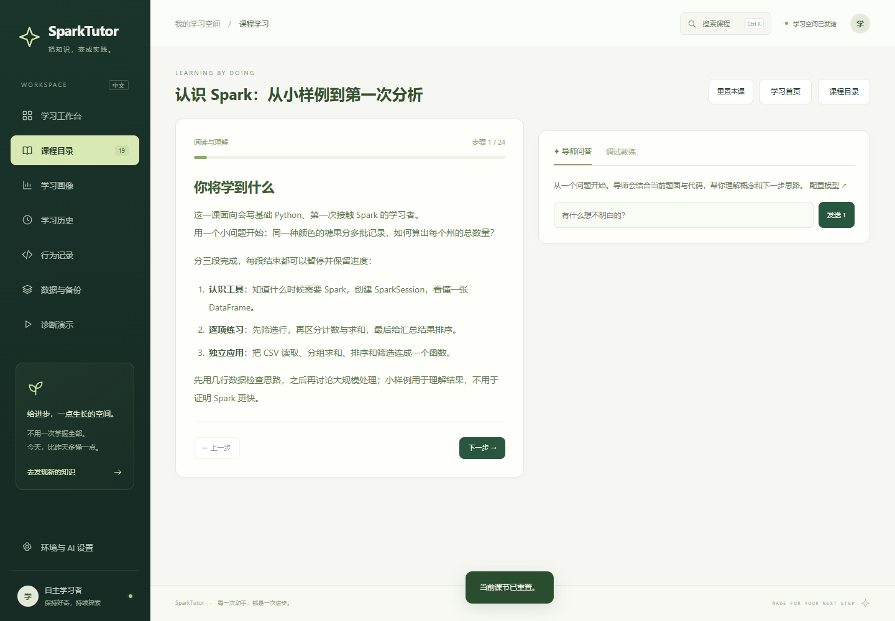

# SparkTutor-CN 网页版：比赛提交与演示说明

本仓库默认分支 `master` 提供网页版本源码。历史 VS Code 扩展保存在 [vscode-legacy 分支](https://github.com/xiangRose/SparkTutor-CN/tree/vscode-legacy)，两者沿用同一项目历史和来源说明。安装命令以 [README](../README.md#新电脑首次安装与启动) 为准。

## 项目定位

SparkTutor-CN 面向会基础 Python、初次系统学习 Spark 的中文学习者，把课程阅读、逐步编程、真实课程测试、调试帮助和历史复盘连接在一个浏览器工作区中。

- 教材 1.2.0，包含 Learning Spark 11 课及 Spark 4.1 教学管道 8 课，共 24 道可执行编程练习。
- 综合题使用课程原始断言；学生修改模板测试区不能替代课程测试，dry-run 不会放行必须真实执行的练习。
- 四维诊断显示知识、调试、求助和迁移的样本依据；推荐来自实际课程并校验前置条件，没有任意加权总分。
- AI 导师用于问答，调试教练在两道已支持练习中选择错误假设和证据；系统核验后展示分层中文提示，不能改分或绕过课程测试。
- 服务端逐题保存代码与进度，支持恢复、冲突检查、参考答案差异、实时输出、历史趋势及数据备份。

截图展示真实网页的课程阅读和导师入口，来自隔离验收环境，不包含真实学生的学习成绩。

## 演示前准备

1. 按 README 在演示主机安装独立环境，确认 Python、Java 和 PySpark，并实际运行待展示的课程测试。已安装依赖和一次 SparkSession 成功均不足以证明所有课程可用。
2. 建立独立演示数据目录，保留个人学习记录。例如 Windows 启动命令可追加 `-DataDir .\.sparktutor-web\competition-demo -Port 8889`，Linux 命令可追加 `--data-dir .sparktutor-web/competition-demo --port 8889`。
3. 演示主机运行服务后，浏览器打开对应端口。若通过局域网访问，对方只需浏览器；当前各浏览器共用该演示实例的数据，不是独立用户账户。
4. 在“环境与 AI 设置”核对当前解释器，选择执行方式并点击“保存设置”。AI 展示需另行配置并实际检查导师或教练连接；无模型时仍可展示课程、真实 Spark 运行与本地诊断。
5. 若准备展示全部诊断阶段，可先使用“诊断演示”的合成轨迹模式核查页面；现场明确说明该轨迹由脚本预设。

## 建议演示顺序

### 1. 从课程目标进入第一道练习

展示学习首页、两套课程与三档难度，打开 Learning Spark 第一课，说明从业务问题、小表格和预期结果逐步过渡到编程练习。新工作区的诊断应显示“证据不足”，不展示虚构的初始成绩。

### 2. 展示真实运行与判题

完成 SparkSession 结构短题，再进入首课筛选行的分步练习。在运行结果中核对真实执行模式；提交时由课程测试判断结果。可演示一次预先说明的错误实现、查看具体反馈，再修改并提交正确实现。

需要明确区分三种结果：短题的本地结构检查、dry-run 的语法检查、真实 Spark 的课程测试。只有最后一种能验证要求实际执行的练习；模型回答不作为这些题目的通过证明。

### 3. 展示证据与恢复

查看对应的行为记录、学习画像和历史复盘，解释分子、分母以及错误修复如何形成证据。刷新页面展示代码和课节位置恢复；必要时展示参考答案差异与答案查看标记。演示者的操作属于功能验收样例，不作为真人教学效果实验结果。

### 4. 展示 AI 调试教练（已配置模型时）

进入支持教练的 M&M 综合题或传感器迁移题，展示“概念提问—检查方法—局部示例”的分层求助及引用依据。说明作者维护提示正文、系统核验引用与样例，模型负责在受限目录内选择。修改代码后仍需提交课程测试验证。

模型连接失败时如实显示未完成状态；不使用预录回复冒充现场调用。没有配置模型时可说明此模块的边界，继续展示无需模型的诊断与课程功能。

### 5. 展示可复现诊断演示

在“诊断演示”分别查看首次迁移通过、首次失败后重试两个场景，展示阶段输出、四维诊断、只读推荐及前后复盘。重点说明：重试可以更新最近知识与调试证据，不能改写首次迁移结果。

合成模式只验证事件和诊断规则；真实 Spark 模式运行预设代码及原课程断言。两种模式均使用脚本轨迹和隔离数据，不代表学生自主作答或学习提升。

### 6. 展示数据管理

查看环境报告、学习摘要和数据库/代码备份入口。课程重置与记录清除需要确认，适合在独立演示目录中进行；不在个人学习目录中为展示效果清空记录。

## 当前能力边界

- 当前为单人学习工作区，未实现公开多用户平台的账户、作业配额及不可信代码隔离。
- 原生 Windows 下部分 Python worker 作业仍有兼容问题。完整真实课程验收以 Linux 环境为基线，现场主机需要单独检查待展示练习。
- 教练目前支持两道练习和有限假设目录；没有训练新的专有模型，也未证明优于普通 AI 导师。
- 四维比例、趋势和推荐是有研究依据的工程操作定义，尚未完成真人教学效果与量表效度验证。预计学习时长同样待真人试学校准。
- 流处理、湖仓和教学管道课程包含明确说明的教学模拟，不能据此声明验证了真实流处理容错、湖仓事务或生产级编排。

## 提交内容与验证依据

源码包括教学引擎、网页资源、19 课教材、课程起始代码与断言、自动化测试和说明文档。个人 `.sparktutor-web` 数据、虚拟环境、密钥及本机 Python 配置不属于源码提交内容；如需提供演示数据，另行提供带来源标记的合成报告。

测试命令见 [开发与验证](../README.md#开发与验证)，分轮验证记录见 [CHANGELOG](../CHANGELOG.md)。静态回归、真实课程执行和真实模型调用分别报告，不用一种检查替代另一种结果。各模块的规则与历史验收依据保留在 [学习诊断设计](learning-diagnosis-model.md)、[教练评估](coach-evaluation.md) 及各阶段验收文档中。

项目基于 [lisancao/sparktutor](https://github.com/lisancao/sparktutor) 改造，保留原作者与团队版权、[MIT 许可](../LICENSE) 和编辑器第三方许可证。
